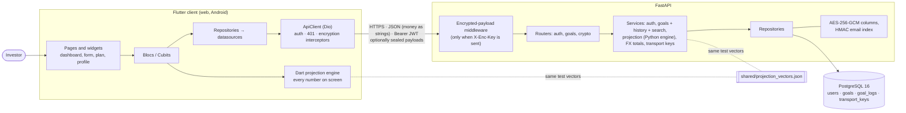
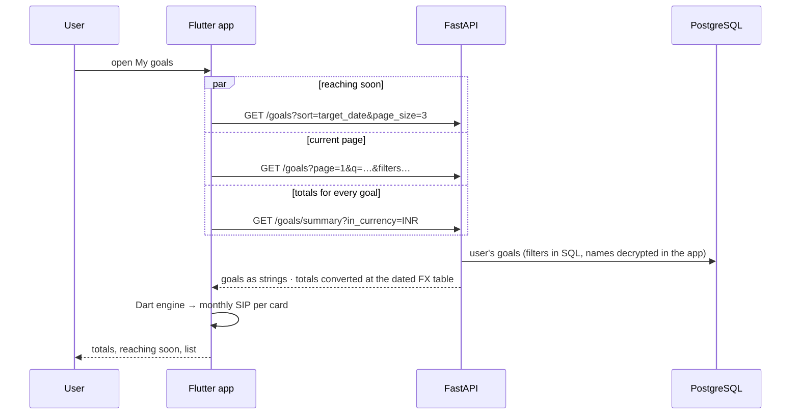
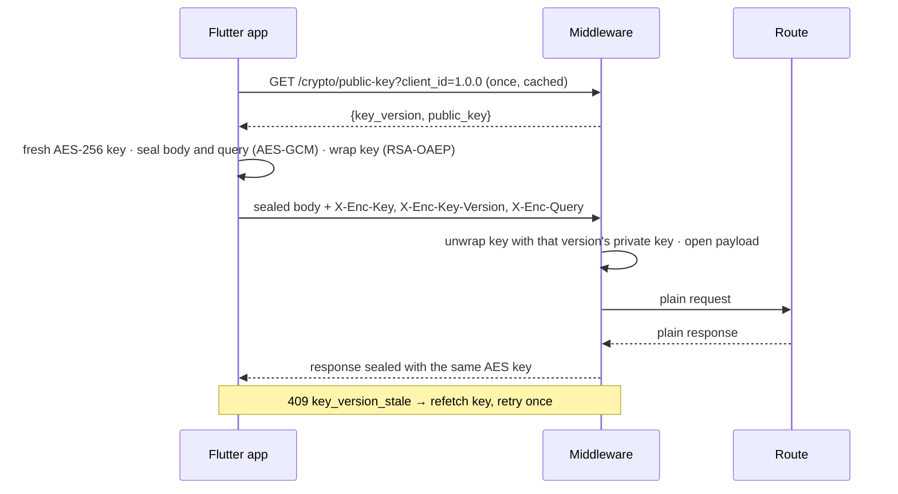

# SIP Goal Planner — High-Level Design

Status: implemented (web and Android client, API, PostgreSQL). Formulas, schema, endpoints and class structure are in [LLD.md](LLD.md).
UI design: [Claude Design canvas "SIP Goal Planner"](https://claude.ai/artifact/JZnvpb88MrMFeTfF3ij4zz) (21 artboards: auth, goal list, goal form, results; desktop and phone; loading, empty, slow, error states). The built app departs from it where later requests asked: rounded raised cards and buttons, a dashboard with search and filters, profile, about, offline and 404 pages.

## 1. Purpose

An investor enters a financial goal and sees:

1. The monthly SIP needed to reach the target by the goal date.
2. How that SIP changes if it steps up by a fixed percentage each year.
3. What the target is worth in today's money after inflation.

Plus a year-by-year corpus projection, a growth chart, and a comparison of the level and step-up plans.

Example: "₹1 crore in 12 years, ₹20,000 already invested, 12% a year."

## 2. Scope

**In scope**

- Email/password registration (last name optional) and login with JWT; each user sees only their own goals. Profile: edit name, change password (current password required).
- Goal CRUD: name, goal type, target amount, target date, current corpus, expected return %, annual step-up %, inflation %. Delete is a soft delete.
- Goal history: every create, update and delete recorded in a log.
- Encryption at rest for personal data: email, first and last name, goal name, history entries.
- All plan maths in the client: live form preview, per-goal SIPs, results screen.
- Projection endpoint on the server (required by the brief): required monthly SIP (level and step-up), inflation-adjusted target, yearly corpus table.
- Dashboard: totals across **all** goals in one currency the user picks (converted at a fixed, dated rate table, computed by the server), "reaching soon" goals, and the full list with name search (debounced), filters (type, currency, timeline, amount), sort and numbered pages.
- **Currency per goal** (11 currencies); the user's default currency pre-fills new goals.
- Optional encrypted request/response payloads (RSA-OAEP + AES-GCM) with versioned server keys, toggled in the UI as a trial.
- English only. Amounts typed into the form are spelled out ("5 lakh 55 thousand 5 rupees").
- Input validation with field-level error messages.
- Database migrations; Swagger UI working out of the box.
- Loading (skeletons), empty, error, slow-network and offline states; 404 for unknown URLs; layouts down to phone width; Android build.
- Compliance: returns labelled as illustrative assumptions; footer disclaimer "Mutual fund investments are subject to market risks."

**Out of scope**

- Password reset, email verification, refresh tokens, social login.
- Translations.
- Converting a goal's own numbers to another currency (D9). Only the dashboard total is converted.
- Live exchange rates; real fund data, NAVs, or tax calculations.
- Rotation of the at-rest data key (the ciphertext is versioned, `v1:`, but no keyring yet).
- Stretch goal (LLM free-text goal entry).
- Hosting (§6).

## 3. Architecture

| Component | Responsibility |
|---|---|
| Flutter client | Clean architecture (presentation / domain / data per feature), flutter_bloc state, Dio network client used only by data-layer datasources. UI, client-side validation, token storage, money formatting. |
| Dart projection engine | Every plan number the app shows: form preview, per-goal SIPs, results screen. |
| Auth router | Register, login (OAuth2 password flow), current user, update name and default currency, change password. |
| Goals router + goal service | CRUD scoped to the authenticated user; soft delete; history; list with filters, search, sort and paging; dashboard totals. Every write and its log row commit in one transaction. |
| Crypto router + transport keys | Public RSA key per app version; rotation and revocation by CLI. |
| Encrypted-payload middleware | Opens sealed requests and seals their responses; plain requests pass through. |
| Crypto (at rest) | Encrypts personal-data columns; HMAC index for email lookup. |
| Money serializer | API strings ↔ `bigint` hundredths (money) and basis points (rates), via `Decimal`. |
| Python projection service | `GET /goals/{id}/projection` for the brief and Swagger, and the dashboard totals. Same formulas, same test vectors. |
| PostgreSQL | Users, goals, goal history, transport keys. No computed results stored. |

### Key flows

Opening the dashboard (three calls in parallel; plans are computed on the device):

Encrypted request (when the lock toggle is on):

## 4. Key decisions

| # | Decision | Reason |
|---|---|---|
| D1 | Client: **Flutter** (web, then Android); API: FastAPI + PostgreSQL | Must be responsive down to phone-width viewports; one codebase for both. |
| D2 | **Maths in the client**; the server stores goals and also exposes the projection | Instant results with no round trip; the endpoint keeps the brief's backend requirement. Drift is caught by one shared set of test vectors both suites must pass. |
| D3 | Projections never stored | Stored results go stale when a goal is edited or time passes. |
| D4 | Effective monthly rate `(1+R)^(1/12) − 1` | 12% a year compounds to exactly 12% a year. |
| D5 | SIP paid at the start of each month (annuity due) | Matches the design and how Indian SIPs are debited. |
| D6 | Other users' goals return 404, not 403 | Does not reveal that the goal exists. |
| D7 | Money and rates travel as **strings**, are converted with `Decimal`, and are stored as **`bigint` × 100**. Maths uses floating point; SIP rounded **up** (to a unit, or to 0.01 when inputs have decimals), everything else half-up to 2 places | No float error in storage or transport; the plan always reaches the target. |
| D8 | English only; server errors carry a `code` plus English `message` | Codes keep client field mapping stable. |
| D9 | Each goal stores its own currency, fixed at creation | Return and inflation assumptions are market-specific, so converting a ₹ goal into $ would mislead. |
| D10 | Dashboard total computed by `GET /goals/summary`, converted with a fixed, dated rate table; always over all goals, independent of list filters | Needs every goal, not one page; deterministic tests; shown as "approximate, at rates from <date>". |
| D11 | Encrypt personal-data columns with AES-256-GCM; email lookup via HMAC-SHA256 | Protects personal data if the database or a backup leaks. Amounts and dates stay plain so `CHECK` constraints work. Cost: no SQL search or sort on those columns. |
| D12 | Primary keys are UUIDv7, generated in the app | Time-ordered ids keep B-tree inserts sequential. |
| D13 | `text` for all strings, `bigint` for all numbers, native enums for fixed sets | Lengths and ranges enforced in schemas and `CHECK` constraints. |
| D14 | Goal history in an append-only `goal_logs` table, written in the same transaction; deletes are soft | Full audit trail; `ON DELETE RESTRICT` everywhere. |
| D15 | Name search: SQL narrows by the plain filters, then names are matched after decryption | Follows from D11; a user's goals are few, so this is cheap. Client debounces 300 ms and drops stale responses. |
| D16 | Optional payload encryption on top of HTTPS: per-request AES-256-GCM key wrapped with RSA-OAEP-SHA256; versioned keys in `transport_keys` (active / retired with 24 h grace / revoked) | Hides payloads from anything terminating TLS in between; rotation without breaking in-flight clients. Not a replacement for HTTPS. |
| D17 | Transport client id = app version from `pubspec.yaml` | Each release has its own keys; an old release can be cut off by revoking them. |

## 5. Trade-offs

1. **Client-side maths vs server-only:** instant results and works while the network is slow; the formula exists twice, held identical by shared vectors.
2. **Column encryption vs plain storage:** a leaked database exposes no emails or goal names; costs SQL search on those columns (D15), key management, and some CPU.
3. **Integer storage vs `numeric`:** `bigint` hundredths are exact, fast and simple; the serializer owns the conversion.
4. **Payload encryption:** extra protection and a key-rotation story, at the cost of request overhead and debuggability (payloads are opaque in dev tools), so it is off by default.

## 6. Runtime and deployment

- Local: `docker compose up` starts PostgreSQL (port 5433) and the API; the API runs `alembic upgrade head` on start.
- Web client: `flutter run -d chrome --web-port 3000` (the API's default CORS origin). Android: emulator reaches the local API at `10.0.2.2`; release APK via `flutter build apk`.
- API URL is a build-time define (`API_BASE_URL`); CORS origins come from env.
- Configuration via environment variables: `DATABASE_URL`, `JWT_SECRET`, `JWT_EXPIRE_MINUTES`, `CORS_ORIGINS`, `DATA_ENCRYPTION_KEY`, `EMAIL_HASH_KEY`, `TRANSPORT_CLIENT_IDS`, `TRANSPORT_KEY_GRACE_HOURS`. The API refuses to start without the three secrets.
- Hosting is deferred. The web build is static; the API and PostgreSQL need their own host.

## 7. Non-functional

- **Security:** bcrypt passwords; personal-data columns encrypted at rest (D11); optional sealed payloads (D16); JWT HS256, 60-minute expiry; every goal query filtered by `user_id` and `deleted_at IS NULL`. Token in browser localStorage (XSS risk accepted; httpOnly cookie + CSRF is the stronger alternative).
- **Errors:** `{"detail": [{"field", "code", "message"}]}` for validation, `{"detail": "..."}` otherwise.
- **Network:** per-request timeout 15 s; "slow connection" notice after 3 s; retry on error screens; full-page offline state that keeps the page underneath intact.
- **Accessibility:** design contrast and 44 px touch targets; offline overlay blocks focus underneath; looping loading animations respect reduced motion.
- **Testing:** pytest against a real PostgreSQL test database; Dart unit, bloc and widget tests; both engines run `shared/projection_vectors.json`; a payload sealed by Python is opened in Dart.
