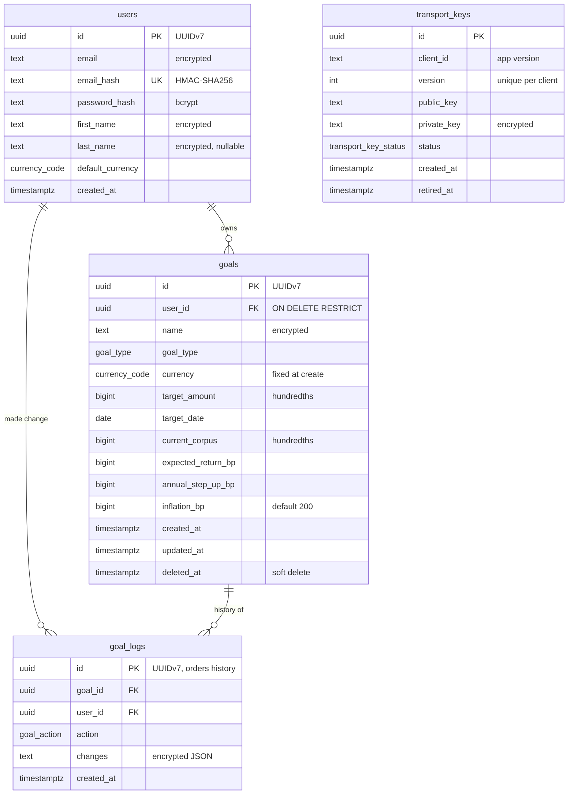
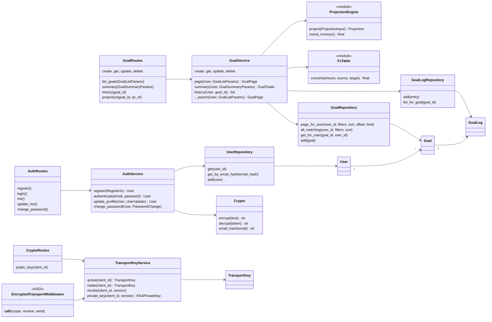
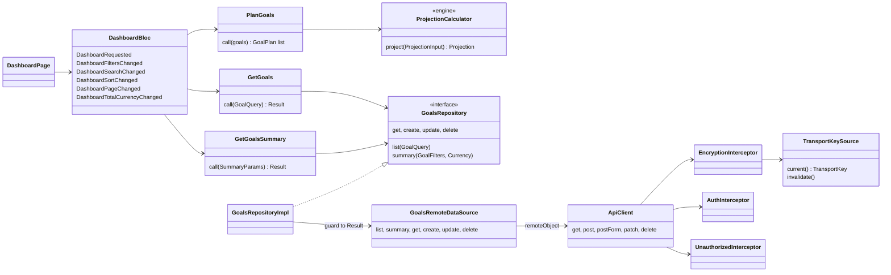
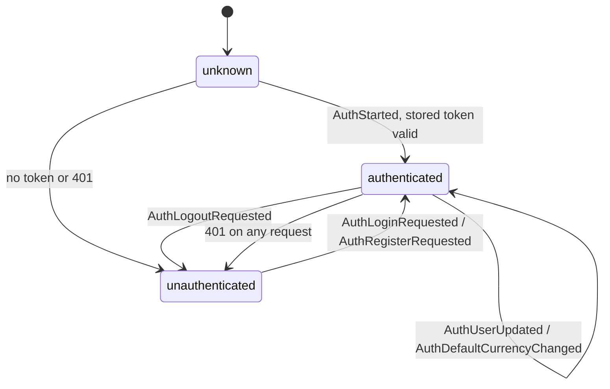

# SIP Goal Planner — Low-Level Design

Status: implemented. Read with [HLD.md](HLD.md).

## 1. Financial maths

Implemented twice with identical behaviour:

- Dart: `frontend/lib/features/projection/domain/engine/projection_calculator.dart`. **Primary.** Produces every number the app shows: form preview, goal list SIPs and total, results screen.
- Python: `backend/app/services/projection.py`. Serves `GET /goals/{id}/projection` (required by the brief; used from Swagger and tests). The app does not call it.

The server never stores computed results; it stores only goals and their history. Both engines are pure; the "as of" date is a parameter. Both must pass every case in `shared/projection_vectors.json` (§7).

### 1.1 Inputs

| Symbol | Meaning |
|---|---|
| `T` | target amount |
| `C0` | current corpus |
| `R` | expected annual return (decimal, e.g. 0.12) |
| `s` | annual step-up (decimal) |
| `π` | annual inflation (decimal) |
| `n` | whole months from `as_of` to `target_date`, minimum 1 |

`n` counts calendar months; if the target day-of-month is earlier than the `as_of` day, the last partial month is dropped.

### 1.2 Formulas

Monthly rate (effective):

```
i = (1 + R)^(1/12) − 1
```

Growth of the existing corpus:

```
FV_c = C0 · (1 + i)^n
```

Gap the SIP must fill:

```
G = T − FV_c
if G ≤ 0: required SIP = 0, on_track = true
```

SIP with annual step-up, paid at the start of each month. Payment in month `m` (0-based) is `P0 · (1+s)^⌊m/12⌋` and compounds for `n − m` months:

```
F  = Σ_{m=0}^{n−1} (1 + s)^⌊m/12⌋ · (1 + i)^(n − m)
P0 = G / F
```

- Level SIP is the same formula with `s = 0`.
- Works unchanged for `i = 0`, goals under 12 months, and partial final years.
- With `s = 0` it must equal the closed form `G / ( ((1+i)^n − 1) / i · (1+i) )` (for `i > 0`), or `G / n` (for `i = 0`).

Target in today's money:

```
today_value = T / (1 + π)^(n/12)
```

### 1.3 Number representation and rounding

| Where | Money | Rates (%) |
|---|---|---|
| API request/response (JSON) | string, e.g. `"2500000.50"` | string, e.g. `"12.5"` |
| Serializer → DB | `Decimal(s) × 100` → `int` (hundredths) | `Decimal(s) × 100` → `int` (basis points: 12.5% → `1250`) |
| DB | `bigint` | `bigint` |
| DB → serializer | `int / 100` → `Decimal` → string with 2 decimals (`"2500000.50"`) | same (`"12.50"`) |
| Client domain | `int` hundredths in entities | `int` basis points |
| Maths (both engines) | `double` / `float` | `bp / 10000` as `double` / `float` |

- Strings are parsed with `Decimal`, never `float`, so `"0.1"` stores exactly `10`.
- More than 2 decimal places is rejected, not rounded (`code: too_many_decimals`). For `JPY` (0 minor digits) any fraction is rejected.
- The scale is 100 for every currency, including `JPY`; `CURRENCY_DECIMALS` only governs validation and display.
- Required SIP: computed in floating point, rounded **up** so the plan still reaches the target: to the next whole currency unit, or to the next 0.01 when the target or current corpus was entered with decimals.
- Every other reported amount (balances, invested, growth, today's value, totals) is rounded half-up to 2 decimal places. Both engines use the same rule (round to 6 places, then half-up), so they agree to the cent.
- Display: amounts with cents show 2 decimals (`₹17,640.80`); whole amounts show none (`₹32,205`); JPY never shows decimals.
- Table values and `today_value`: rounded to 2 decimals for display.

### 1.4 Year-by-year schedule

Simulated month by month with the rounded SIP: `balance = (balance + sip) · (1 + i)`, starting from `balance = C0`. One row per goal year; the last may cover fewer than 12 months. Produced for both plans.

| Field | Meaning (design column) |
|---|---|
| `year` | 1-based goal year ("Year") |
| `calendar_year` | calendar year the row ends in ("· 2027") |
| `months` | months in the row (12, or fewer for the last) |
| `monthly_sip` | SIP during this year ("Monthly SIP") |
| `invested_to_date` | `C0` + all SIPs so far ("Put in so far") |
| `growth_to_date` | `closing_balance − invested_to_date` ("Growth so far") |
| `closing_balance` | corpus at end of the row ("Total worth") |
| `goal_pct` | `closing_balance / T · 100`, capped display at 100 ("Goal reached") |

### 1.5 Plan summary (per plan)

| Field | Meaning |
|---|---|
| `first_year_sip` | SIP in year 1 |
| `final_year_sip` | SIP in the last year |
| `total_invested` | `C0` + all SIPs |
| `growth` | final balance − `total_invested` |
| `final_balance` | balance at the target date (≥ `T`) |

### 1.6 Worked example (reference vector)

Target 1,00,00,000, 144 months, `C0` = 20,000, `R` = 12%, `π` = 6%:

| Output | Value |
|---|---|
| `i` | 0.0094888 |
| `G` | 99,22,080 |
| Level SIP | 32,205 (exact 32,204.55) |
| Step-up SIP at 10%, first year | 20,519 (exact 20,518.76) |
| Today's value | 49,69,693.64 |

## 2. Repository layout

```
backend/
  app/
    main.py                  app, routers, exception handlers, CORS, encrypted-payload middleware
    core/config.py           settings from env (pydantic-settings)
    core/security.py         bcrypt hashing, JWT encode/decode
    core/crypto.py           AES-256-GCM column encryption, HMAC email index
    core/transport_crypto.py RSA-OAEP key wrap, AES-GCM sealing for payloads (§5a)
    db/session.py            engine, SessionLocal, get_db
    db/types.py              EncryptedText, EncryptedJSON (SQLAlchemy TypeDecorators)
    models/                  User, Goal, GoalLog, TransportKey, enums.py
    schemas/                 Pydantic models; money.py (string ↔ int hundredths);
                             goal_query.py (filters, search, paging, summary)
    api/deps.py              get_current_user, service dependencies
    api/encrypted_transport.py  ASGI middleware (§5a)
    api/routes/              auth.py, goals.py, crypto.py
    repositories/            UserRepository, GoalRepository, GoalLogRepository
    services/                auth_service, goal_service (+ history, search, summary),
                             projection (pure), fx (dated rate table), transport_keys
  alembic/versions/          0001 schema · 0002 first/last name · 0003 optional last name ·
                             0004 inflation default 2% · 0005 transport_keys
  scripts/                   generate_secrets.py, rotate_transport_key.py, create_test_db.sql
  tests/
  Dockerfile
frontend/                    Flutter app, web and Android (§6)
shared/projection_vectors.json
docker-compose.yml           db + api
docs/
```

## 3. Data model

### Enums

Defined once in Python (`app/models/enums.py`) as `StrEnum`s and stored as native PostgreSQL enum types via `sqlalchemy.Enum(..., name=..., values_callable=lambda e: [m.value for m in e])`. The same classes type the Pydantic schemas, so Swagger lists the allowed values.

| PostgreSQL type | Python enum | Values |
|---|---|---|
| `currency_code` | `Currency` | `INR`, `USD`, `EUR`, `GBP`, `AED`, `SGD`, `AUD`, `CAD`, `JPY`, `CNY`, `BRL` |
| `goal_type` | `GoalType` | `home`, `education`, `retirement`, `car`, `wedding`, `travel`, `emergency_fund`, `other` |
| `goal_action` | `GoalAction` | `created`, `updated`, `deleted` |
| `transport_key_status` | `TransportKeyStatus` | `active`, `retired`, `revoked` |

- The initial Alembic migration creates all types before the tables; downgrade drops them after.
- Adding a value later needs its own migration with `ALTER TYPE ... ADD VALUE` (autogenerate does not detect enum value changes).
- Each currency also carries its minor-unit digits (`JPY` = 0, others = 2) for rounding and display, in a `CURRENCY_DECIMALS` map next to the enum.
- The Flutter client mirrors both enums in `domain/entities` with `fromJson`/`toJson` on the string value; an unknown value fails parsing loudly rather than defaulting.

### Conventions

- All primary keys: `uuid` holding a **UUIDv7**, generated in Python (`uuid6.uuid7()`; PostgreSQL 16 has no native `uuidv7()`). Time-ordered, so inserts stay index-friendly and ids sort by creation.
- No `varchar`: every string column is `text`. Length limits live in the Pydantic schemas (and in `CHECK (char_length(...))` where the column is not encrypted).
- No `numeric`: money and rates are `bigint` (§1.3).
- Timestamps: `timestamptz`, UTC.

### Encryption at rest

| Column | Stored as | Why |
|---|---|---|
| `users.email` | `text`: AES-256-GCM ciphertext | personal data |
| `users.email_hash` | `text`: HMAC-SHA256 hex of the lowercased email, **unique** | login lookup and uniqueness without decrypting |
| `users.first_name`, `users.last_name` | `text`: ciphertext | personal data |
| `goals.name` | `text`: ciphertext | free text, may name family members ("Aanya's education") |
| `goal_logs.changes` | `text`: ciphertext of the JSON diff | contains old/new names |

- `core/crypto.py`: `encrypt(plaintext: str) -> str` returns `"v1:" + base64(nonce ‖ ciphertext ‖ tag)` with a random 12-byte nonce; `decrypt` reverses it. The `v1:` prefix allows key rotation later.
- `EncryptedText` / `EncryptedJSON` TypeDecorators encrypt on bind and decrypt on load, so models and services handle plaintext.
- Keys from env: `DATA_ENCRYPTION_KEY` (32 bytes, base64) and `EMAIL_HASH_KEY` (separate HMAC key). The app refuses to start without them.
- Amounts, rates and dates stay plaintext `bigint` / `date`: not identifying on their own, and needed for `CHECK` constraints.
- Passwords are not encrypted; they are hashed with bcrypt (one-way).

### users

| Column | Type | Notes |
|---|---|---|
| `id` | uuid (v7) | PK |
| `email` | text | encrypted, stored lowercased before encryption |
| `email_hash` | text | unique |
| `password_hash` | text | bcrypt |
| `first_name` | text | encrypted; required at registration (1–50 chars) |
| `last_name` | text, nullable | encrypted; optional (≤ 50 chars). Migration 0002 split existing display names into first/last; 0003 made it nullable. |
| `default_currency` | `currency_code` | default `INR`. Pre-fills new goals and the My goals total. |
| `created_at` | timestamptz | default now() |

### goals

| Column | Type | Notes |
|---|---|---|
| `id` | uuid (v7) | PK |
| `user_id` | uuid | FK → users.id, **ON DELETE RESTRICT**, indexed with `deleted_at` |
| `name` | text | encrypted |
| `goal_type` | `goal_type` | |
| `currency` | `currency_code` | set on create, cannot be changed |
| `target_amount` | bigint | hundredths; CHECK > 0 |
| `target_date` | date | |
| `current_corpus` | bigint | hundredths; default 0, CHECK ≥ 0 |
| `expected_return_bp` | bigint | basis points; CHECK 0–3000 |
| `annual_step_up_bp` | bigint | basis points; default 0, CHECK 0–2500 |
| `inflation_bp` | bigint | basis points; default 200, CHECK 0–1200 |
| `created_at` | timestamptz | default now() |
| `updated_at` | timestamptz | set on every write |
| `deleted_at` | timestamptz | null = active. Soft delete. |

A goal's amounts are always in its own `currency` (HLD D9). "Target date in the future" is enforced in the API, not the DB. Every goal query filters `deleted_at IS NULL`; a deleted goal returns 404.

### goal_logs

One row per change to a goal, written by `goal_service` in the same transaction as the change (not a DB trigger: triggers can't encrypt).

| Column | Type | Notes |
|---|---|---|
| `id` | uuid (v7) | PK; time-ordered, so it also orders the history |
| `goal_id` | uuid | FK → goals.id, ON DELETE RESTRICT, indexed |
| `user_id` | uuid | FK → users.id, ON DELETE RESTRICT; who made the change |
| `action` | `goal_action` | `created`, `updated`, `deleted` |
| `changes` | text | encrypted JSON. `created`: full snapshot. `updated`: only changed fields, `{"field": {"old": ..., "new": ...}}`. `deleted`: full snapshot. Values in API string form. |
| `created_at` | timestamptz | default now() |

- An update that changes nothing writes no log row.
- Logs are append-only: no update or delete endpoint.

### transport_keys

RSA key pairs for encrypted payloads (§5a), one row per (client, version).

| Column | Type | Notes |
|---|---|---|
| `id` | uuid (v7) | PK |
| `client_id` | text | the app version, e.g. `1.0.0` |
| `version` | integer | unique together with `client_id` |
| `public_key` | text | SPKI DER, base64 |
| `private_key` | text | PKCS#8 PEM, **encrypted** (`EncryptedText`) |
| `status` | `transport_key_status` | at most one `active` per client (partial unique index) |
| `created_at` | timestamptz | default now() |
| `retired_at` | timestamptz | set on rotation; a retired key still works for `TRANSPORT_KEY_GRACE_HOURS` |

### Entity-relationship diagram



### Backend class diagram

Routes are thin; services hold the rules; repositories own every query (always scoped to the user, skipping deleted rows).



## 4. API

Base path `/api/v1`. All routes except register and login require `Authorization: Bearer <token>`.

| Method | Path | Request | Success | Errors |
|---|---|---|---|---|
| POST | `/auth/register` | `{first_name, last_name, email, password}` | 201 `User` | 409 `email_taken`, 422 |
| POST | `/auth/login` | form `username`, `password` (OAuth2) | 200 `{access_token, token_type}` | 401 |
| GET | `/auth/me` | — | 200 `User` | 401 |
| PATCH | `/auth/me` | `{default_currency?, first_name?, last_name?}`; an empty `last_name` clears it | 200 `User` | 401, 422 |
| POST | `/auth/me/password` | `{current_password, new_password}` | 204 | 401, 422 `password_incorrect`, `password_unchanged`, `password_weak` |
| GET | `/goals` | query: `page` (≥1), `page_size` (1–100, default 10), `sort` (`newest` \| `target_date` \| `target_amount`), filters `currency`, `goal_type`, `min_target_amount`, `max_target_amount`, `target_year_from`, `target_year_to`; `q` (≤ 100 chars) matches goal names, case-insensitive | 200 `{items: [Goal], page, page_size, total, total_pages}` | 401, 422 |
| GET | `/goals/summary` | same filters, plus `in_currency` (default: the user's) and `as_of` | 200 `{count, currency, total_monthly_sip, total_target, converted, rates_as_of}` | 401, 422 |
| POST | `/goals` | `GoalCreate` | 201 `Goal` | 401, 422 |
| GET | `/goals/{id}` | — | 200 `Goal` | 401, 404 |
| PATCH | `/goals/{id}` | `GoalUpdate` (all optional) | 200 `Goal` | 401, 404, 422 |
| DELETE | `/goals/{id}` | — | 204 (soft delete + `deleted` log) | 401, 404 |
| GET | `/goals/{id}/history` | — | 200 `[GoalLogEntry]`, oldest first | 401, 404 |
| GET | `/goals/{id}/projection` | — | 200 `Projection` | 401, 404 |
| GET | `/crypto/public-key` | query `client_id` (the app version); no auth | 200 `{client_id, key_version, algorithm, public_key}` | 400 `client_unknown` |

- `User` = `{id, email, first_name, last_name, default_currency}`.
- Amount filters compare raw amounts in each goal's own currency, so the client enables them only when a currency filter is set. Year filters become date bounds, so the `(user_id, target_date)` index can be used.
- The dashboard makes three calls: `sort=target_date&page_size=3` for "Reaching soon", the filtered/searched page, and `/goals/summary` **without** filters, so the totals always cover every goal. Filter, sort, page and search changes reload only the list.
- Search: names are encrypted, so the plain filters run in SQL and names are matched after decryption, then paged in Python (HLD D15).
- `Goal` = `{id, name, goal_type, currency, target_amount, target_date, current_corpus, expected_return_pct, annual_step_up_pct, inflation_pct, created_at, updated_at}`; amounts and percentages are strings (§1.3).
- `GoalCreate` includes `currency` (defaults to the user's `default_currency`); `GoalUpdate` rejects `currency`.
- `GoalLogEntry` = `{id, action, changes, created_at}`.
- The goal list returns stored data only; each card's SIP is computed by the client (§6). The cross-goal total needs every matching goal, so `/goals/summary` computes it on the server, using the Python engine (same shared vectors) and the fixed FX table in `app/services/fx.py`.
- Login uses the OAuth2 password form so the Swagger "Authorize" button works.

### Projection response

```json
{
  "as_of": "2026-11-18",
  "months": 144,
  "currency": "INR",
  "monthly_rate": 0.0094888,
  "target_amount": "10000000.00",
  "current_corpus": "20000.00",
  "corpus_future_value": "77919.52",
  "gap": "9922080.48",
  "today_value": "4969693.64",
  "on_track": false,
  "assumptions_note": "Returns are illustrative assumptions, not guaranteed.",
  "level":   { "first_year_sip": "32205.00", "final_year_sip": "32205.00", "total_invested": "...", "growth": "...", "final_balance": "...", "rows": [ ... ] },
  "step_up": { "step_up_pct": "10.00", "first_year_sip": "20519.00", "final_year_sip": "...", "total_invested": "...", "growth": "...", "final_balance": "...", "rows": [ ... ] }
}
```

Money in the response uses the same string format as goals.

## 5. Validation

Server returns `{"detail": [{"field", "code", "message"}]}`. The client maps each `code` to the field and shows `message`.

| Field | Rule | `code` | English message |
|---|---|---|---|
| `email` | valid email | `email_invalid` | "Enter a valid email address." |
| `email` | not registered | `email_taken` | "This email already has an account." |
| `password` | ≥ 8 chars, ≥ 1 letter, ≥ 1 digit | `password_weak` | "Use at least 8 characters, including a letter and a number." |
| `name` | 1–100 chars, trimmed | `name_required` | "Name is required." |
| `goal_type` | allowed value | `goal_type_invalid` | "Choose a goal type." |
| money, percentages | string parseable as a decimal number | `not_a_number` | "Enter a number." |
| money, percentages | ≤ 2 decimal places (0 for `JPY` money) | `too_many_decimals` | "Use at most 2 decimal places." |
| `target_amount` | > 0, ≤ 1,000,000,000,000 | `amount_positive` | "Target amount must be greater than 0." |
| `current_corpus` | ≥ 0 | `amount_negative` | "Amount already invested cannot be negative." |
| `target_date` | > today | `date_past` | "Target date must be in the future." |
| `expected_return_pct` | 0–30 | `return_range` | "Expected return must be between 0% and 30%." |
| `annual_step_up_pct` | 0–25 | `step_up_range` | "Yearly increase must be between 0% and 25%." |
| `inflation_pct` | 0–12 | `inflation_range` | "Inflation must be between 0% and 12%." |
| `currency`, `default_currency` | allowed value | `currency_invalid` | "Unsupported currency." |
| `currency` on PATCH goal | not allowed | `currency_locked` | "A goal's currency can't be changed. Create a new goal instead." |

| `first_name` | 1–50 chars, trimmed | `name_required`, `name_too_long` | "Enter your first name." |
| `last_name` | optional, ≤ 50 chars | `name_too_long` | "Use at most 50 characters." |
| `current_password` | matches the stored hash | `password_incorrect` | "Current password is incorrect." |
| `new_password` | differs from the current one | `password_unchanged` | "Choose a different password." |
| `q` (search) | ≤ 100 chars | `search_too_long` | "Search with at most 100 characters." |

Confirm-password matching is client-only.

## 5a. Encrypted payloads (trial, off by default)

On top of HTTPS, the app can seal every request and response body (and query string) so
that anything terminating TLS in between — a proxy, a logging layer — sees only ciphertext.
Toggled by the lock button in the nav bar; Swagger and plain clients are unaffected.

| Step | Who | What |
|---|---|---|
| 1 | client | `GET /crypto/public-key?client_id=<app version>` (from `pubspec.yaml`, e.g. `1.0.0`) → `{key_version, public_key}` (RSA-3072, SPKI DER base64). Cached until the server says it's stale. |
| 2 | client | Per request: random AES-256 key; body sealed with AES-256-GCM (AAD `req:METHOD:/path`), query sealed with AAD `req:METHOD:/path?`; key wrapped with RSA-OAEP-SHA256. |
| 3 | client | Sends `X-Enc-Client`, `X-Enc-Key-Version`, `X-Enc-Key`, `X-Enc-Content-Type`, `X-Enc-Query`; body = sealed payload. |
| 4 | server | `EncryptedTransportMiddleware` unwraps the key with that version's private key, restores the body, content type and query, runs the request normally. |
| 5 | server | Seals the response (errors included) with the same AES key, AAD `res:STATUS:METHOD:/path`; real content type in `X-Enc-Content-Type`. `204`/`304` and `HEAD` responses carry no body and pass through unsealed. |
| 6 | client | Opens the response with the key it kept. |

Sealed format: `base64(nonce[12] || ciphertext || tag[16])`. The AAD binds a payload to its
method and path (the raw, percent-encoded path the client sent), and a response also to its
status. A plaintext query on an encrypted request is rejected (it could only have been
injected), bodies over 1 MB get `413`, and an unknown client id gets `400 client_unknown`.

**Keys and rotation.** The client id is the app version, so each release has its own keys and
retiring an old release means revoking its key; `TRANSPORT_CLIENT_IDS` lists the supported
versions. `transport_keys` holds one row per (client, key version): the public key,
the private key (encrypted at rest with `DATA_ENCRYPTION_KEY`), and a status:

- `active`: handed out by step 1; at most one per client (partial unique index).
- `retired`: replaced by `scripts/rotate_transport_key.py <app version>`; still accepted for
  `TRANSPORT_KEY_GRACE_HOURS` (24) so in-flight clients aren't cut off.
- `revoked`: `--revoke <version>`; rejected at once.

A stale version gets `409 key_version_stale`; the client refetches the key and retries once.
Revoking the active key is allowed: the next public-key request issues the next version.
Rotation is an operator CLI; two rotations of one client at the same instant would collide on
the unique version and one would fail.

**Limits.** Not a substitute for HTTPS: the public key itself arrives over TLS. No replay
window beyond the endpoint binding (a captured request can be re-sent to the same endpoint).
Headers, method and path stay visible.

**At-rest keys.** Column ciphertext carries a `v1:` prefix, but `DATA_ENCRYPTION_KEY`
rotation (keyring + re-encryption job) is not implemented yet.

## 6. Client (Flutter: web and Android)

### 6.1 Structure

Clean architecture, feature-first. Dependencies point inward: `presentation → domain ← data`. `domain` is plain Dart with no Flutter, Dio or JSON imports.

```
frontend/lib/
  main.dart                       bootstraps DI, runs App
  app/
    app.dart                      MaterialApp.router inside SafeArea; AuthBloc + ConnectivityCubit; OfflineGate
    router.dart                   go_router; redirects on AuthBloc state; keeps deep links via ?from=; 404 errorBuilder
    theme/                        design tokens (§6.2), ThemeData
  core/
    di/injection.dart             get_it registrations
    config/app_config.dart        API_BASE_URL (10.0.2.2 on the Android emulator)
    network/                      dio_client, api_client, remote_call (remoteObject / remoteVoid), guard,
                                  api_exception, endpoints, connectivity_service,
                                  interceptors/{auth, unauthorized, encryption}
    security/                     encryption_settings, hybrid_cipher, transport_key_source
    domain/                       currency, scaled (string ↔ int hundredths), rounding
    format/                       money_formatter, amount_words
    presentation/                 event_transformers (debounce), haptics, slow_notice
    error/                        failure.dart (sealed), result.dart (Success | Err)
    storage/                      token_storage
    usecase/                      UseCase<T, Params>
  features/
    auth/        data · domain · presentation   auth_page, profile_page; AuthBloc, ProfileCubit
    goals/       data · domain · presentation   dashboard_page, goal_form_page; DashboardBloc, GoalFormBloc;
                                                goal_query (filters, search, Paged), GoalFormValidator
    projection/  domain · presentation          engine, CalculateProjection, PlanGoals; goal_plan_page;
                                                ProjectionBloc, PlanPreviewCubit (no data layer)
    about/       presentation                   about_page, SIP impact examples
  shared/
    connectivity/                 ConnectivityCubit, OfflineGate and OfflinePage
    widgets/                      app_shell, app_footer, elevated_card, gold_button, loading_visuals,
                                  state_views, encryption_toggle, not_found_page, world_network_background
```

### Client class diagram

One feature end to end (goals); auth and projection follow the same shape.



`DashboardSearchChanged` is debounced 300 ms (restartable); a list response is dropped if a newer query replaced it.

Session state (`AuthBloc`), which the router redirects on:



#### Layer rules

| Layer | Holds | May import |
|---|---|---|
| `domain` | entities, abstract repositories, use cases, projection engine | `core/error`, `core/usecase` only |
| `data` | remote datasources, JSON models (`extends`/maps to entities), repository implementations | `domain`, `core/network`, `core/storage` |
| `presentation` | Blocs/Cubits, pages, widgets | `domain` (use cases, entities), `core/format`, `shared` |

- Datasources call `ApiClient` through `remoteObject` / `remoteVoid`, which turn a missing or mistyped payload into `MalformedResponseApiException`; they never use `!` on JSON.
- Repository implementations catch `ApiException`, map to `Failure`, return `Result<T>`. Nothing above `data` sees Dio or `ApiException`.
- Blocs call use cases only, never repositories or datasources.

#### Network client (Dio)

`DioClient` builds one `Dio`, registered as a singleton in `get_it`:

- `BaseOptions`: `baseUrl` from `const String.fromEnvironment('API_BASE_URL')`, JSON content type, `receiveTimeout` and `sendTimeout` 15 s. `connectTimeout` is not relied on (unreliable on web).
- Interceptors, in order: `EncryptionInterceptor` (when the toggle is on: seals body and query, opens the sealed response, retries once on `409 key_version_stale`; §5a), `AuthInterceptor` (reads `TokenStorage`), `UnauthorizedInterceptor` (on 401 clears the token and notifies `AuthBloc`), `LogInterceptor` in debug builds only.

`ApiClient` wraps it for datasources:

```dart
Future<dynamic> get(String path, {Map<String, dynamic>? query, CancelToken? cancel});
Future<dynamic> post(String path, {Object? body, CancelToken? cancel});
Future<dynamic> postForm(String path, Map<String, String> fields);   // OAuth2 login
Future<dynamic> patch(String path, {Object? body});
Future<void>    delete(String path);
```

Each call adds an overall `.timeout(15 s)` and converts every `DioException` / `TimeoutException` into one `ApiException`:

| `ApiException` | From | `Failure` |
|---|---|---|
| `TimeoutApiException` | timeout | `NetworkFailure(timeout: true)` |
| `NetworkApiException` | connection error | `NetworkFailure()` |
| `UnauthorizedApiException` | 401 | `AuthFailure()` |
| `NotFoundApiException` | 404 | `NotFoundFailure()` |
| `ValidationApiException(fieldErrors)` | 409 or 422 `{detail:[{field,code,message}]}` | `ValidationFailure(fieldErrors)` |
| `MalformedResponseApiException` | body missing or wrongly typed | `ServerFailure()` |
| `ServerApiException` | 5xx, anything else | `ServerFailure()` |

#### State management (flutter_bloc)

| Bloc / Cubit | Events / methods | States |
|---|---|---|
| `AuthBloc` | `AuthStarted`, `AuthLoginRequested`, `AuthRegisterRequested`, `AuthLogoutRequested`, `AuthDefaultCurrencyChanged`, `AuthUserUpdated`, `AuthFailureCleared`, session expiry | one `AuthState(status: unknown / authenticated / unauthenticated, user, submitting, failure)` |
| `ProfileCubit` | `saveName`, `changePassword` | `ProfileState` with a status and failure for each form |
| `DashboardBloc` | `DashboardRequested`, `DashboardFiltersChanged`, `DashboardSearchChanged` (300 ms debounce, restartable), `DashboardSortChanged`, `DashboardPageChanged`, `DashboardTotalCurrencyChanged` | one `DashboardState`: status, isSlow, reachingSoon, page of `GoalPlan`s, summary, query, listLoading, failure |
| `GoalFormBloc` | `GoalFormStarted`, `GoalFormChanged`, `GoalFormSubmitted` (droppable) | one `GoalFormState` with input, validation, status, failure |
| `PlanPreviewCubit` | `update(GoalDraft?)` | `Projection?`; local engine, no network |
| `ProjectionBloc` | `ProjectionRequested`, `PlanModeToggled`, `GoalDeleteRequested` | `ProjectionLoading(isSlow)`, `ProjectionLoaded(goal, projection, mode)`, `ProjectionError`, `GoalDeleted` |
| `ConnectivityCubit` | `check()` | `bool` online |

- States use `equatable`.
- Slow network: a loading bloc starts a 3 s `Timer` when it emits `Loading`; if no result yet, it re-emits `Loading(isSlow: true)`. The timer is cancelled on result and in `close()`.
- `GoalFormBloc` uses `bloc_concurrency`'s `droppable()` on `Submitted` so double taps send one request.
- Retry buttons re-dispatch the original request event.
- English UI only; the design's language picker is removed from the account menu.
- `Money` parses API strings (`"2500000.50"`) into `int` hundredths without going through `double`, and serialises back to the same string form. Form inputs are kept as strings until submit.
- FX lives on the server (`app/services/fx.py`, ECB snapshot dated 18 Nov 2026): `convert(amount, from, to) = amount / rates[from] * rates[to]`. Used only for the dashboard total, never for a goal's own numbers.
- Money formatter takes the currency code explicitly: `formatMoney(amount, currency)`. Locale per currency follows the design: INR → `en-IN` (lakh/crore), GBP → `en-GB`, others → `en-US`.
- The account menu's currency control is labelled "Default currency for new goals".
- Chart: `fl_chart`; total worth over money put in (growth is the gap), dashed goal line, the year the goal is reached, the other plan as a faint line when step-up > 0, and a per-year tooltip (worth, put in, growth, SIP, goal %). Yearly tables over 8 years collapse to key years with "Show all N years".

### 6.2 Design tokens (from the canvas)

| Token | Value |
|---|---|
| background | `#0b0b0c` |
| layer / layer2 / field | `#161618` / `#1f1f22` / `#232327` |
| border / border-strong | `#2e2e33` / `#6b6b70` |
| text / text2 / text3 | `#f2f0ea` / `#b3b0a8` / `#8f8c84` |
| accent (gold) / hover / on-accent | `#d4af37` / `#e2c15a` / `#0b0b0c` |
| danger / danger-bg | `#ff6b6b` / `#2d1215` |
| success / success-bg | `#42be65` / `#0e2a17` |
| series 1 (level) / series 2 (step-up) | `#5b8def` / `#b38c25` |
| font | IBM Plex Sans 300/400/600 |
| shape | rounded raised cards (16 px) and buttons (12 px); gold gradient primary button with a shine; fields with a bottom border in every state; 32 px pill chips |

### 6.3 Screens

| Screen | Content | States |
|---|---|---|
| Log in / Create account | email, password (show/hide); on register confirm password and first / last (optional) name; benefits panel; blurred globe backdrop | submitting, field errors with summary banner |
| My goals | "All goals" jump button; totals card across every goal (count, total monthly SIP in a picked currency, total of targets; "Approximate, at rates from <date>"); reaching soon; all goals with search, type chips, currency / timeline / amount / sort menus, numbered pages | skeletons over the money matrix with tips, slow notice, empty (CTA + templates), no match, error + retry |
| New / Edit goal | type chips, name, currency (create only), target amount and already invested with the amount spelled out, target date; return chips (8 / 10 / 12, default 10), step-up and inflation sliders (default 0% and 2%) with a haptic tick; live preview (bottom bar + sheet on phones) | field errors with count banner, preview hidden while invalid, saving |
| Goal plan | header with Edit / Delete; plan toggle (hidden at 0% step-up) with hero SIP; breakdown; today's money; chart; yearly table (key years, expandable); comparison (hidden at 0%); "How we work this out" | loading, slow notice, error + retry, on-track message |
| Profile | first / last name, email (read-only); change password | saving, field errors |
| About | what GoalPlanner is, SIP impact examples | — |
| Offline / 404 | full-page "Oops! No internet" with retry; 404 with a link home | — |

Every amount is formatted in the currency of the goal it belongs to; only the My goals total uses the picked currency.

### 6.4 Network states

- Every request wrapped in a 15 s timeout.
- If still pending after 3 s, show the slow-connection notice from the design.
- Timeout or no connection → error view with retry; form input is never lost.
- 401 → clear token, route to log in.

### 6.5 Layout

- Content max width 1120 px, centred; two columns on desktop, one below 640 px.
- Yearly and comparison tables scroll horizontally on narrow screens.
- Footer pinned to the bottom of short pages: "Mutual fund investments are subject to market risks." and the copyright line; results add the assumptions and "This is not investment advice."

## 7. Tests

### 7.1 Shared vectors (`shared/projection_vectors.json`)

Each case: inputs (`as_of`, `target_date`, `T`, `C0`, `R`, `s`, `π`) and expected outputs (`months`, `level_sip`, `step_up_first_sip`, `today_value`, `on_track`). Run by both pytest and `flutter test`; values must match exactly after rounding.

| Case | Expectation |
|---|---|
| Worked example (§1.6) | 32,205 / 20,519 / 49,69,693.64 |
| Zero return | SIP = ceil(G / n) |
| Step-up 0% | Level SIP = step-up SIP = closed form |
| Goal under 1 year (7 months) | One schedule row, `months = 7` |
| Corpus already exceeds target | SIP 0, `on_track = true` |
| 30% return, 25% step-up | Upper bounds compute without overflow |

### 7.2 Backend (pytest, 108 tests)

- Shared vectors, schedule reaches target, closed-form agreement, rounding to cents.
- Auth: full flow, duplicate email (case-insensitive), weak password, bad tokens, optional last name, password change.
- Goals: ownership (404 for another user), validation codes, currency lock, JPY precision, money serializer, encryption at rest (raw SQL shows `v1:`), history rows, soft delete, UUIDv7 ordering, projection endpoint, default inflation.
- List: filters, sort, paging, name search (case-insensitive, combined with filters, too long rejected), summary totals across currencies.
- Encrypted payloads: both directions with JSON and form bodies and sealed queries, sealed errors, unsealed 204s, tampering and cross-endpoint replay rejected, plaintext-query injection rejected, oversized bodies, rotation grace and revocation (including the active key), private keys encrypted at rest.
- Migrations: down to base and back up; data backfills.

### 7.3 Client (flutter test, 72 tests)

- Dart engine: shared vectors, closed form, step-up and cents rounding; rounding helpers match the backend.
- Money: string ↔ int parsing, formatting (INR lakh/crore, other currencies, JPY), amounts in words.
- Form validator mirrors the API rules.
- Network: `ApiClient` error mapping; `remoteObject` turns malformed payloads into errors; `EncryptionInterceptor` against a fake server (seal/open, form bodies, 204, stale-key retry, sealed errors, off); a Python-sealed payload opened in Dart.
- Blocs: `DashboardBloc` (load, slow, empty, error, paging, filters keep totals, debounced search), `ProfileCubit`, connectivity.
- Widgets: live preview panel, offline gate, footer pinned on short pages, text field height stable on focus.
